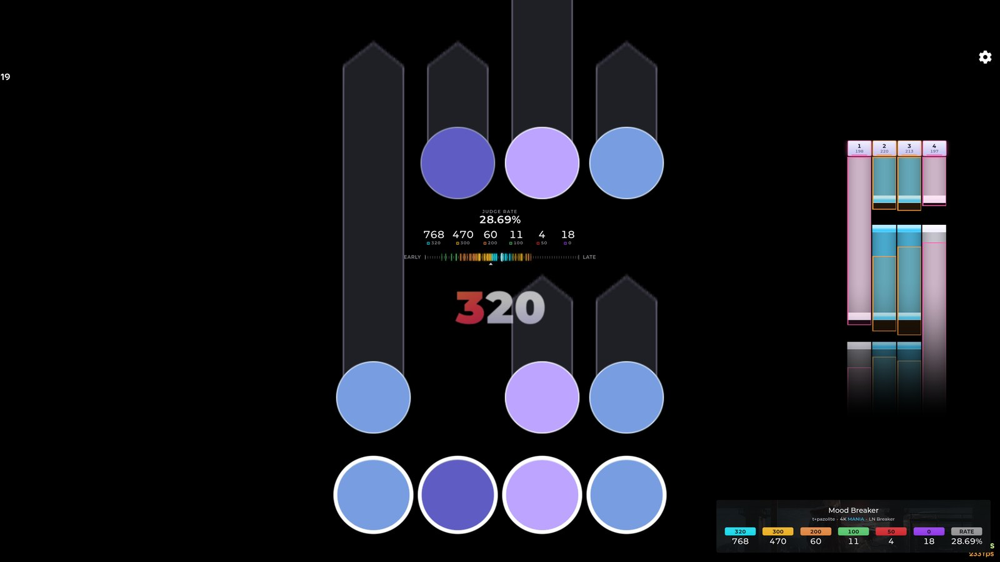
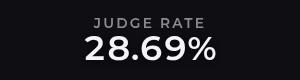
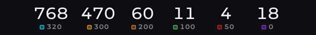
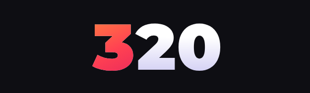
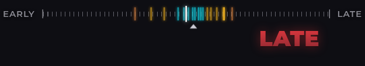
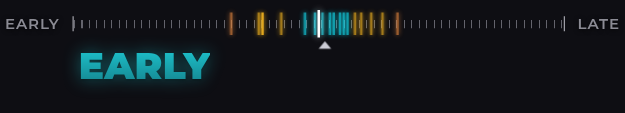
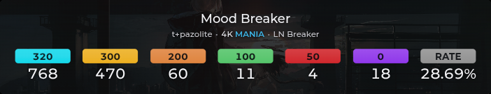
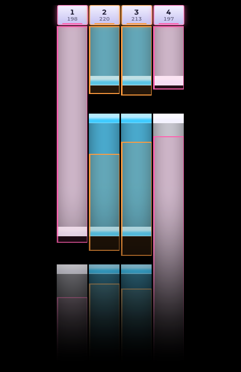

# EZ2ON REBOOT : R 2.0 overlays for vosu

Fan recreations of the EZ2ON REBOOT : R 2.0 beta gameplay UI as [vosu](https://github.com/shiruviaa/vosu) overlays for osu!. They work in every ruleset (standard, taiko, catch, mania) and can be shown in OBS or in-game through [vosulay](https://github.com/shiruviaa/vosulay). Tested on osu!lazer; osu!stable should work but hasn't been tested.

## Overlays

Each overlay is its own folder, so you can install only the ones you want.

| Overlay | Preview |
| --- | --- |
| **EZ2ON Judge Rate** (`ez2on-judge-rate`, 240×64) Accuracy over the whole map: starts at 0% and only reaches 100% when every object gets the best judgement. |  |
| **EZ2ON Judgement Counts** (`ez2on-judgement-counts`, 500×56) Judgement counts with osu! names: 320 300 200 100 50 0 in mania, 300 100 50 0 in standard, 300 100 0 in taiko, 300 0 in catch. |  |
| **EZ2ON Judgement Popup** (`ez2on-judgement-popup`, 500×150) The big judgement text on every hit. Resize the overlay to resize the text. |  |
| **EZ2ON Timing Bar** (`ez2on-timing-bar`, 500×90) Hit offsets coloured by judgement, with an average marker. EARLY pops up on the left and LATE on the right; both colours are configurable. |   |
| **EZ2ON Play Information** (`ez2on-play-info`, 780×150) Song card over the dimmed beatmap background: title, artist, mode, difficulty, judgement chips and rate. |  |
| **EZ2ON Key Visualizer** (`ez2on-key-visualizer`, 480×720) Your presses and holds scroll past, drawn over the notes you just played (mania, including converts, key mods and Dual Stages). Other modes show presses only. |  |

The sizes are the recommended overlay sizes; vosu shows them on each overlay's dashboard card.

## Installation

These overlays aren't in the tosu/vosu counter catalog, so they are installed by hand.

1. Download `ez2on-overlays.zip` from the [latest release](../../releases/latest).
2. Extract the zip. It contains one folder per overlay (`ez2on-judge-rate`, `ez2on-timing-bar`, …).
3. Move those folders into vosu's static folder:

   | System | Static folder |
   | --- | --- |
   | Windows | the `static` folder next to `vosu.exe` |
   | Linux | `~/.local/share/vosu/static/` (or `$XDG_DATA_HOME/vosu/static/`) |

   If you set `STATIC_FOLDER_PATH` in vosu's settings, use that folder instead.

   Each overlay folder must sit directly inside `static`, for example `static/ez2on-timing-bar/index.html`. Don't leave them inside an extra folder.
4. Open the vosu dashboard (`http://127.0.0.1:24050/`). The overlays appear with your other installed overlays. Add them to OBS with the URL on each card, or place them in-game with vosulay.

To update, download the new release and replace the folders. Your settings are stored by vosu, not inside the folders, so they are kept.

## Settings

Open an overlay's settings from the vosu dashboard. Every overlay has a **Visibility** setting (gameplay only, gameplay and results, or always). Other notable settings:

- **Timing Bar:** EARLY / LATE colours, EARLY / LATE threshold, how long hits stay on the bar.
- **Key Visualizer:** scroll direction and speed (`auto` follows your osu! mania settings), fading, key boxes, note and press colours per key count, an input offset, and a frame rate limit (60 fps by default; `0` redraws on every frame).
- **Play Information:** background dim, unicode titles.

## Requirements

- [vosu](https://github.com/shiruviaa/vosu). The judgement overlays read standard tosu fields, but the timing bar and key visualizer rely on vosu-only data (per-key press timestamps), so tosu isn't supported.
- For in-game display, [vosulay](https://github.com/shiruviaa/vosulay). Set its FPS limit (Settings → Advanced) to 60–120, preferably one that divides your refresh rate evenly. Its `auto` setting renders the overlays at your display's refresh rate. On a 360 Hz display with OBS capturing the game, that lowered osu! from 720 to about 400 fps even on an RTX 5090, while limits of 60–180 kept it at 720.

## Credits

- Design recreated from [EZ2ON REBOOT : R](https://store.steampowered.com/app/1477590/EZ2ON_REBOOT__R/) 2.0 by Neonovice Co., Ltd. and SQUARE PIXEL. This is an unofficial fan project, not affiliated with or endorsed by them.
- Mania conversion in the key visualizer is ported from [rosu-pp](https://github.com/MaxOhn/rosu-pp) (MIT, MaxOhn) and [osu!lazer](https://github.com/ppy/osu) (MIT, ppy).
- [Montserrat](https://github.com/JulietaUla/Montserrat) font, SIL Open Font License 1.1 (see `fonts/OFL.txt` in each overlay).

## License

[MIT](LICENSE), except the bundled Montserrat font (SIL OFL 1.1).
